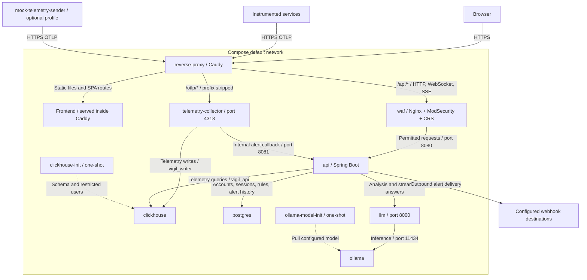
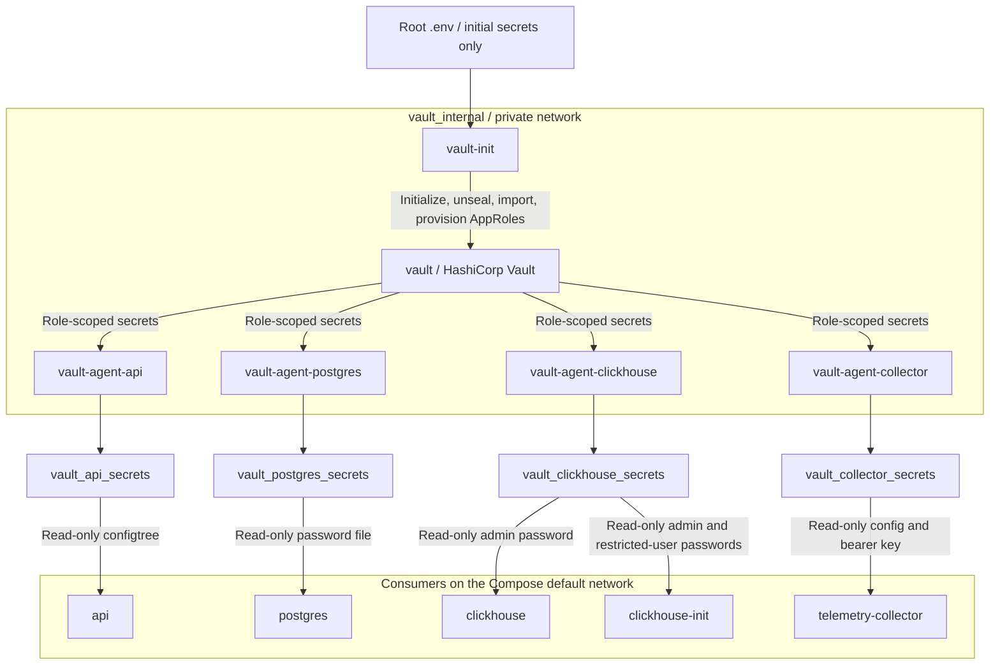

# Vigil Security Module: WAF and HashiCorp Vault

This module provides Web Application Firewall (WAF) protection and centralized secret management for Vigil.

**Note:** This is a development/demonstration implementation, not a production-ready security deployment.

## Architecture

**Application and telemetry traffic:**



Caddy is the only published ingress. Frontend assets are built into its image, not served by a separate frontend container. API traffic passes through WAF; OTLP bypasses WAF and is authenticated by the collector. The optional mock sender runs on the host network and uses the same HTTPS ingress as real producers. The callback URL must target `http://api:8081/internal/alerts/trigger-evaluation`. Solid arrows show runtime requests or data access; dashed arrows show one-shot provisioning.

**Secret management:**



Applications do not connect to Vault's network: role-specific volumes bridge secret delivery between the two networks. Bootstrap also writes AppRole credentials to separate per-role volumes mounted only by the corresponding agents. Caddy, WAF, the LLM service, and Ollama do not consume Vault secret volumes. The API's persisted admin API key and Caddy's public CA are managed separately; see [initialization and persistence](SECURITY-DESIGN.md#3-initialization-and-persistence).

## Components

### Web Application Firewall

- Nginx with ModSecurity and OWASP Core Rule Set (CRS).
- Protects `/api/*` traffic.
- Operates behind the existing Caddy reverse proxy.
- Uses blocking paranoia level 2 and an inbound anomaly threshold of 5.
- Supports API methods including PUT/PATCH/DELETE, WebSocket upgrades, and unbuffered SSE.
- Limits credential-password and TLS-address JSON exceptions to the relevant fields and routes; other inputs remain inspected.

### HashiCorp Vault

- Uses persistent file-based storage.
- Initializes and unseals automatically for demonstration purposes.
- Imports initial credentials from the root `.env` file.
- Uses AppRole authentication and four Vault Agents.
- Generates secret files in Docker volumes for the API, PostgreSQL, ClickHouse, and telemetry collector.

The initial credentials imported are:

- `JWT_SECRET`
- `POSTGRES_PASSWORD`
- `CLICKHOUSE_PASSWORD`
- `CLICKHOUSE_API_PASSWORD`
- `CLICKHOUSE_WRITER_PASSWORD`
- `VIGIL_INGESTION_KEY`

Bootstrap imports application secrets once, using the existing API document as the import marker. Restarts reuse Vault state and existing AppRole credential files; only missing credential files are created. Revoked AppRole credentials require manual replacement.

The only automatic application-secret migration is adding a missing API `VIGIL_INGESTION_KEY` from the existing collector document. This prevents the API from generating a different ingestion key at startup. It does not rotate any database password or JWT secret.

Bootstrap reads basic plain or quoted `.env` values as data, without `source` or `eval`. Use literal single-line values rather than shell expressions or interpolation. Changing `.env` after import does not update Vault.

#### API configtree contract

With `SPRING_CONFIG_IMPORT=configtree:/run/secrets/`, the filenames below resolve the **exact uppercase placeholders** already used by `services/api/src/main/resources/application.properties`. They are not environment variables and do not need to be renamed to canonical property names.

| Rendered file | API property | Vault source |
| --- | --- | --- |
| `JWT_SECRET` | `vigil.jwt-secret` | API JWT secret |
| `SPRING_DATASOURCE_PASSWORD` | `spring.datasource.password` | PostgreSQL password |
| `CLICKHOUSE_PASSWORD` | `clickhouse.password` | **Restricted `vigil_api` password**, not the admin password |
| `VIGIL_INGESTION_KEY` | `vigil.ingestion-key` | Same key used by the collector |

The configtree import is non-optional. Secret values are not duplicated in the API's Compose environment, where they could override Vault.

#### Collector contract and permissions

The collector template retains nonsecret `${env:...}` settings. Its writer password is JSON-quoted for YAML, with dollar escaping for the config resolver. Bearer authentication reads `filename: /run/secrets/VIGIL_INGESTION_KEY`, using the same ingestion key delivered to the API.

Agents read private AppRole files and render `0444` secret files in `0755` directories so nonroot consumers can read them. Each consumer mounts only its own secret volume read-only.

#### Existing data

For first import into an existing installation, `.env` must match its database credentials. PostgreSQL's password file only initializes a new database; rendered-file changes are not coordinated password rotation or application reloads. ClickHouse provisioning must complete before API/collector startup.

Keep the existing `postgres_data` and `clickhouse_data` volumes. Back up Vault, bootstrap credentials, and databases consistently; do not use `docker compose down -v` or volume pruning as a migration step. Bootstrap does not reconcile incomplete or inconsistent secret documents.

## Deployment

The security services are integrated into the main `docker-compose.yml`, alongside the existing API configuration, admin-key persistence, and TLS feature.

From the project root:

```bash
docker compose up -d --build
```

For a fresh deployment, populate the required variables in the root `.env` file before starting the containers.

Do not commit `.env`, Vault initialization credentials, or generated secret files.

### Current Compose integration

- **API:** retains frontend URLs, LLM settings, native forwarded-header handling, `VIGIL_API_KEY_FILE`, public-CA trust, and admin-key persistence alongside read-only Vault configtree delivery.
- **Vault:** uses the official image entrypoint with `command: [server]`; the entrypoint already loads `/vault/config`.
- **Bootstrap:** remains running to unseal Vault after reseals. Agents wait for its healthy state, which requires `/vault/init/ready` and an unsealed Vault after import and AppRole provisioning.
- **Agents:** healthchecks require their rendered files, including the API and collector ingestion-key files. Consumers wait for their agents and mount secrets read-only. File readiness is not a credential-consistency or automatic-reload guarantee.
- **Collector/databases:** retain the collector's secret-config command, successful ClickHouse provisioning dependency, and original database volume names.

## Verification

**Normal API request:**

```bash
curl -k -o /dev/null -w '%{http_code}\n' \
  https://localhost:8443/api/auth/sessions
```

Expected: `401` (authentication required).

**WAF SQL injection test:**

```bash
curl -k -o /dev/null -w '%{http_code}\n' \
  --get --data-urlencode "id=1' OR '1'='1" \
  https://localhost:8443/api/auth/sessions
```

Expected: `403` (request blocked).

To confirm the block came from ModSecurity CRS rather than the application, inspect the WAF audit logs.

**Container health:**

```bash
docker compose ps -a
```

Check that Vault bootstrap, the Vault Agents, PostgreSQL, ClickHouse, and WAF are healthy. One-shot database/model initialization containers may exit successfully with code 0; Vault bootstrap must remain running.

## Tests

See [security checks](tests/README.md) for smoke checks, the isolated WAF suite, and the real application suite:

```sh
python3 security/tests/test-fullstack.py
```

The fullstack harness also supports the separate [TLS runtime suite](../services/reverse-proxy/README.md#tests). These checks use disposable resources and synthetic credentials. They do not establish production hardening, exhaustive Vault recovery behavior, or safe database upgrades.

## Security Limitations

- Vault uses single-node file storage.
- Vault traffic uses HTTP within a private Docker network.
- The demonstration bootstrap stores the root token and unseal key in a persistent Docker volume. Any compromise of that container or the Docker host defeats the separation; production must not use this automatic-root bootstrap design.
- AppRole SecretIDs are reusable and non-expiring, agents run as root, rendered files are world-readable within their role-specific volumes, and Vault memory locking is disabled. These are explicit demonstration tradeoffs, not production hardening.
- Initial secrets are imported from the root `.env` file.
- Docker network isolation does not prevent every form of lateral access between containers.
- WebSocket URLs containing tokens may be captured by proxy or application logs.
- Production deployments require stronger key management, TLS, access controls, and a security review.

## Project Files

- `waf/`: Nginx, ModSecurity, CRS configuration, and custom rules.
- `vault/config/`: Vault server configuration.
- `vault/scripts/`: Initialization, agent startup, and service integration scripts.
- `vault/agent/`: Vault Agent configurations and templates.
- `vault/policies/`: AppRole access policies.
- `tests/`: Security smoke, isolated WAF, and real fullstack checks.

The main `docker-compose.yml` contains the integrated service definitions.