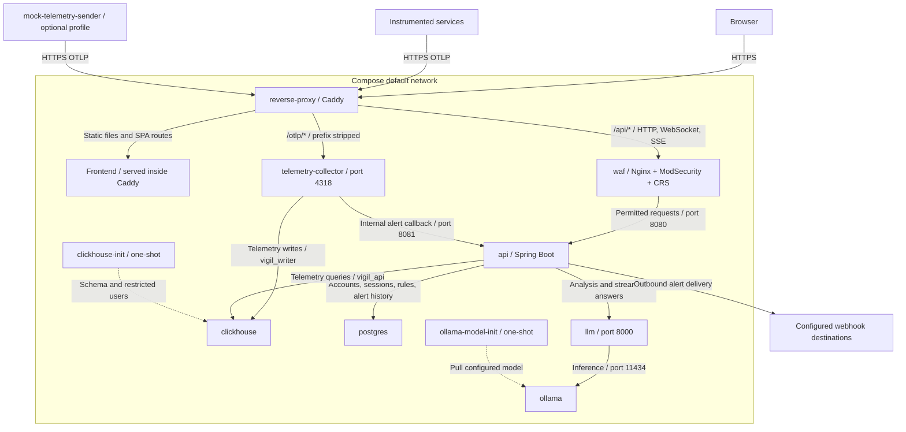
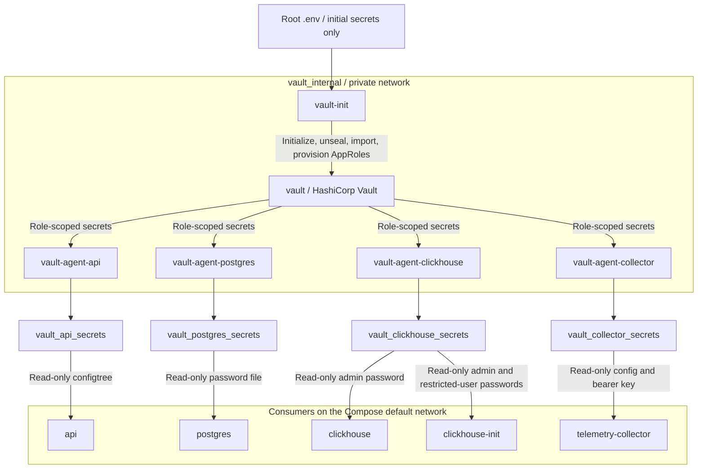

# Vigil Security Module: WAF and HashiCorp Vault

This module provides Web Application Firewall (WAF) protection and centralized secret management for Vigil.

**Note:** This is a development/demonstration implementation, not a production-ready security deployment.

## Architecture

**Application and telemetry traffic:**



Caddy is the only published ingress. Frontend assets are built into its image, not served by a separate frontend container. API traffic passes through WAF; OTLP bypasses WAF and is authenticated by the collector. The optional mock sender runs on the host network and uses the same HTTPS ingress as real producers. The callback URL must target `http://api:8081/internal/alerts/trigger-evaluation`. Solid arrows show runtime requests or data access; dashed arrows show one-shot provisioning.

**Secret management:**



Applications do not connect to Vault's network: role-specific volumes bridge secret delivery between the two networks. Bootstrap also writes AppRole credentials to separate per-role volumes mounted only by the corresponding agents. Caddy, WAF, the LLM service, and Ollama do not consume Vault secret volumes. The API's persisted admin API key and Caddy's public CA are managed separately; see [initialization and persistence](SECURITY-DESIGN.md#3-initialization-and-persistence).

## Components

### Web Application Firewall

- Nginx with ModSecurity and OWASP Core Rule Set (CRS).
- Protects `/api/*` traffic.
- Operates behind the existing Caddy reverse proxy.
- Uses blocking paranoia level 2 and an inbound anomaly threshold of 5.
- Supports the application's API, WebSocket, and SSE endpoints.

### HashiCorp Vault

- Uses persistent file-based storage.
- Initializes and unseals automatically for demonstration purposes.
- Imports initial credentials from the root `.env` file.
- Uses AppRole authentication and four Vault Agents.
- Generates secret files in Docker volumes for the API, PostgreSQL, ClickHouse, and telemetry collector.

The initial credentials imported are:

- `JWT_SECRET`
- `POSTGRES_PASSWORD`
- `CLICKHOUSE_PASSWORD`
- `CLICKHOUSE_API_PASSWORD`
- `CLICKHOUSE_WRITER_PASSWORD`
- `VIGIL_INGESTION_KEY`

Existing secrets are retained in Vault across container restarts. Bootstrap validates all four role documents and their shared credentials; an incomplete import, soft-deleted document, missing field, or mismatched password stops bootstrap rather than overwriting persisted credentials from `.env`. Repair incomplete state using verified original credentials or restore a matching Vault backup. Do not delete database volumes to repair secret delivery.

The only automatic application-secret migration is adding a missing API `VIGIL_INGESTION_KEY` from the existing collector document. This prevents the API from generating a different ingestion key at startup. It does not rotate any database password or JWT secret.

Bootstrap reads `.env` as data, never as shell code. It supports CRLF, simple unquoted values, single-quoted literals, simple double-quoted values, `export`, and inline comments. It deliberately rejects multiline secrets, unquoted/double-quoted interpolation, and double-quoted escape sequences instead of silently importing a password different from Docker Compose's interpretation. Resolve such values before first import; use single quotes for literal dollars/backslashes. Ingestion keys must not contain whitespace. Changing `.env` after import does not update Vault.

#### API configtree contract

With `SPRING_CONFIG_IMPORT=configtree:/run/secrets/`, the filenames below resolve the **exact uppercase placeholders** already used by `services/api/src/main/resources/application.properties`. They are not environment variables and do not need to be renamed to canonical property names.

| Rendered file | API property | Vault source |
| --- | --- | --- |
| `JWT_SECRET` | `vigil.jwt-secret` | API JWT secret |
| `SPRING_DATASOURCE_PASSWORD` | `spring.datasource.password` | PostgreSQL password |
| `CLICKHOUSE_PASSWORD` | `clickhouse.password` | **Restricted `vigil_api` password**, not the admin password |
| `VIGIL_INGESTION_KEY` | `vigil.ingestion-key` | Same key used by the collector |

The import must remain non-optional. Do not also inject these secret values through the API's Compose environment, where they could override Vault. The current application's empty JWT/ingestion-key fallbacks generate random replacements; file existence alone is not sufficient validation of a deployment.

#### Collector contract and permissions

`vault/agent/collector-config.tpl` mirrors `services/telemetry-collector/runtime/config.yaml` and the custom exporter's `buildtime/exporter/config.go`. Nonsecret exporter and processor settings remain `${env:...}` references. The writer password is JSON-quoted (valid YAML) with dollar escaping for the collector's config resolver. Bearer authentication uses `filename: /run/secrets/VIGIL_INGESTION_KEY`, supported by the pinned `bearertokenauthextension` v0.160.0; this setting is not named `token_file`.

Agents run as root to read `0600` AppRole files in `0700` credential directories. Rendered secret files are intentionally `0444` inside separate per-service volumes; output directories are `0755` so the distroless collector's nonroot UID can traverse them. Consumers must mount only their own secret volume read-only. Do not mount bootstrap credentials or other roles' volumes into application services.

#### Existing databases and rotation

- On the **first Vault import**, `.env` must contain the credentials already in use by any persisted databases. Vault cannot discover or reconcile database role passwords.
- PostgreSQL's `POSTGRES_PASSWORD_FILE` initializes a new data directory only. Changing its contents does **not** alter a persisted role's password; `pg_isready` can remain healthy while API authentication fails. Verify with an authenticated TCP connection from a non-loopback address.
- The ClickHouse wrapper preserves the official image entrypoint. `clickhouse-init` must still complete before the API/collector start: the underlying database script creates/alters the restricted users on both fresh and persisted installations. It may reapply passwords on each run, but it does not drop telemetry tables.
- Existing `vigil_writer` privileges are not revoked by the underlying initialization script. A previously overprivileged writer can retain grants beyond the intended table-level `INSERT, SELECT`; audit and revoke them separately in `services/telemetry-db/clickhouse-init.sh`. That script also stores the writer credential using `plaintext_password`; prefer a compatible hashed authentication mode when changing it.
- Agent refreshes are not coordinated database rotation or application reloads. After an explicit credential change, update the database and all corresponding Vault role documents together, rerun ClickHouse initialization where relevant, and restart affected applications. The API/configtree and collector exporter do not automatically reload every changed secret.
- Back up and restore `vault_data`, `vault_init`, and the database volumes consistently. Never use `docker compose down -v` or prune deployment volumes as a migration step.

## Deployment

The security services are integrated directly into the project's main `docker-compose.yml`. Compose retains develop's API configuration and admin persistence alongside Vault integration. Validation uses disposable Docker resources; it does not deploy or modify an existing installation.

From the project root:

```bash
docker compose up -d --build
```

For a fresh deployment, populate the required variables in the root `.env` file before starting the containers.

Do not commit `.env`, Vault initialization credentials, or generated secret files.

### Current Compose integration

1. **API:** uses non-optional `SPRING_CONFIG_IMPORT: "configtree:/run/secrets/"` and all three mounts: `caddy_public_ca:/etc/vigil/ca:ro`, `vault_api_secrets:/run/secrets:ro`, and `api_admin_credentials:/var/lib/vigil/admin`. Develop's frontend URL aliases, silence timeout, LLM settings, `SERVER_FORWARD_HEADERS_STRATEGY`, and `VIGIL_API_KEY_FILE` are retained, without direct `JWT_SECRET` or `VIGIL_INGESTION_KEY` environment injections. The persisted admin API-key file is a separate develop feature, not one of the Vault secrets.
2. **Vault server:** uses the image's official entrypoint with `command: [server]`, which starts the Vault server as the `vault` user. The entrypoint checks the top-level `/vault/file` owner and recursively changes ownership only if that owner differs; it does **not** guarantee repair of root-owned descendants beneath an already Vault-owned parent. Audit mixed ownership before reusing volumes from a root-run server, and repair it deliberately with backups rather than deleting data. The entrypoint already loads `/vault/config`: adding `-config=/vault/config/vault.hcl` with `command: [server, ...]` would load the listener twice and fail with `address already in use`. A read-only-config `chown` warning is benign. With this demonstration's `disable_mlock=true`, Compose sets `SKIP_SETCAP: "true"`; `IPC_LOCK` is unnecessary in that mode.
3. **Bootstrap readiness:** `vault-init` has the healthcheck below, and **all four agents** depend on `vault-init: {condition: service_healthy}`. The script maintains `/vault/init/ready` only after secret validation and AppRole provisioning. `vault-init` stays running as the automatic-unseal watcher; it is not a `service_completed_successfully` job.

   ```yaml
   healthcheck:
     test: [CMD-SHELL, "test -f /vault/init/ready && vault status >/dev/null 2>&1"]
     interval: 5s
     timeout: 5s
     retries: 40
   ```

4. **Secret readiness:** the API agent healthcheck requires all four files in the configtree table, including `VIGIL_INGESTION_KEY`. The collector agent healthcheck requires both `collector-config.yaml` and `VIGIL_INGESTION_KEY`. Database-agent checks and consumer `service_healthy` dependencies are retained. These checks establish initial file delivery, not ongoing freshness; Docker health changes do not automatically stop dependent containers already running.
5. **Collector/DB integration:** the collector uses `[/vigcol, --config, /run/secrets/collector-config.yaml]`, read-only secret mounts, and the API/collector dependency on successful `clickhouse-init`. Existing `postgres_data`/`clickhouse_data` volume names are preserved; do not replace them to force initialization. Test the actual configured PostgreSQL major version and volume layout before upgrading; the isolated regression suite uses PostgreSQL 17.

For production, replace the old floating `hashicorp/vault:1.17` tag with a reviewed, supported patched version pinned to an exact version/digest across the server, bootstrap, and agents; retest configuration compatibility.

## Verification

**Normal API request:**

```bash
curl -k -o /dev/null -w '%{http_code}\n' \
  https://localhost:8443/api/auth/sessions
```

Expected: `401` (authentication required).

**WAF SQL injection test:**

```bash
curl -k -o /dev/null -w '%{http_code}\n' \
  --get --data-urlencode "id=1' OR '1'='1" \
  https://localhost:8443/api/auth/sessions
```

Expected: `403` (request blocked).

To confirm the block came from ModSecurity CRS rather than the application, inspect the WAF audit logs.

**Container health:**

```bash
docker compose ps -a
```

Check that Vault bootstrap, the Vault Agents, PostgreSQL, ClickHouse, and WAF are healthy. One-shot database/model initialization containers may exit successfully with code 0; Vault bootstrap must remain running.

## Testing Status

Run the targeted regression checks from the repository root:

```bash
python3 security/vault/tests/test_bootstrap.py -v
python3 -u security/vault/tests/test_integration.py
```

The parser tests run offline. Docker integration requires Python/PyYAML and the `hashicorp/vault:1.17` image. Optional checks accept API and collector image names through `--api-image` and `--collector-image`; the API check also requires Java 21. Collector checks require `python:3.13-alpine` for HTTP probes and the mock callback. Database checks require `postgres:17-alpine` and `clickhouse/clickhouse-server:26.8.6.5`.

To build the application images and enable all optional checks:

```bash
docker build -t vigil-api:test services/api
docker build -t vigil-telemetry-collector:test -f services/telemetry-collector/buildtime/Dockerfile services/telemetry-collector
python3 -u security/vault/tests/test_integration.py --api-image vigil-api:test --collector-image vigil-telemetry-collector:test --databases
```

The suite uses existing images; pull the prerequisite images before running it. Without `--databases`, the collector check sends empty OTLP requests to test authentication without exporting records. With it, the suite also exports a real synthetic log to isolated ClickHouse and verifies the mock callback. It never reads the project `.env`, calls Compose, publishes ports, or uses deployment volumes; it cleans up its uniquely named test resources on normal completion/failure.

The targeted suite verifies real Vault bootstrap/rendering, role-isolated ACLs, nonroot secret access, collector YAML/template parity, actual Spring configtree placeholder resolution using the API image's libraries and current application properties, legacy ingestion-key migration, revoked AppRole recovery, retention of Vault credentials after `.env` changes, incomplete-state refusal, and fresh/persisted PostgreSQL/ClickHouse behavior. It also checks missing/empty secret rejection in the ClickHouse wrappers.

With `--collector-image`, the suite runs the actual nonroot collector's `validate` command on the unchanged rendered secret volume, starts that image without a user override, and exercises valid, missing, and incorrect bearer credentials on `/v1/logs`, `/v1/metrics`, and `/v1/traces`. The optional real-log export additionally checks that the collector resolves the escaped writer password correctly. This is **not** a full Compose deployment test: API/WAF routing and full application startup remain separate checks. These checks do not constitute a complete production security assessment.

## Security Limitations

- Vault uses single-node file storage.
- Vault traffic uses HTTP within a private Docker network.
- The demonstration bootstrap stores the root token and unseal key in a persistent Docker volume. Any compromise of that container or the Docker host defeats the separation; production must not use this automatic-root bootstrap design.
- AppRole SecretIDs are reusable and non-expiring, agents run as root, rendered files are world-readable within their role-specific volumes, and Vault memory locking is disabled. These are explicit demonstration tradeoffs, not production hardening.
- Initial secrets are imported from the root `.env` file.
- Docker network isolation does not prevent every form of lateral access between containers.
- WebSocket URLs containing tokens may be captured by proxy or application logs.
- Production deployments require stronger key management, TLS, access controls, and a security review.

## Project Files

- `waf/`: Nginx, ModSecurity, CRS configuration, and custom rules.
- `vault/config/`: Vault server configuration.
- `vault/scripts/`: Initialization, agent startup, and service integration scripts.
- `vault/agent/`: Vault Agent configurations and templates.
- `vault/policies/`: AppRole access policies.
- `tests/`: Security smoke tests.

The main `docker-compose.yml` contains the integrated service definitions.