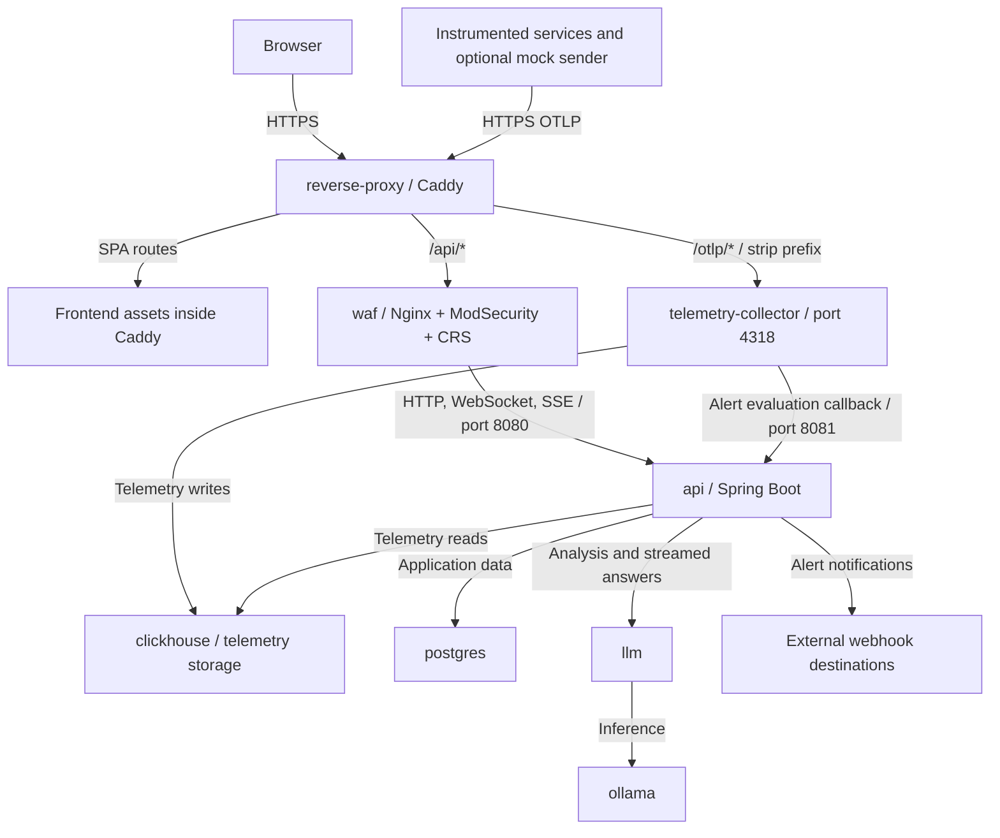
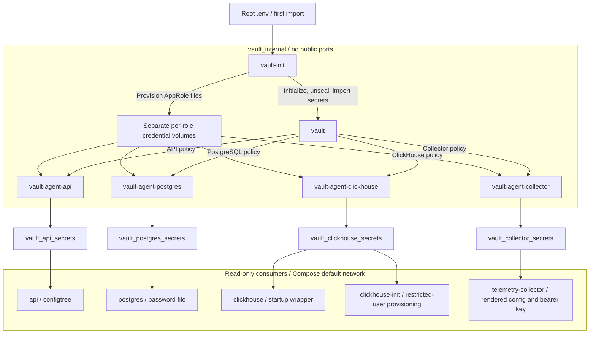
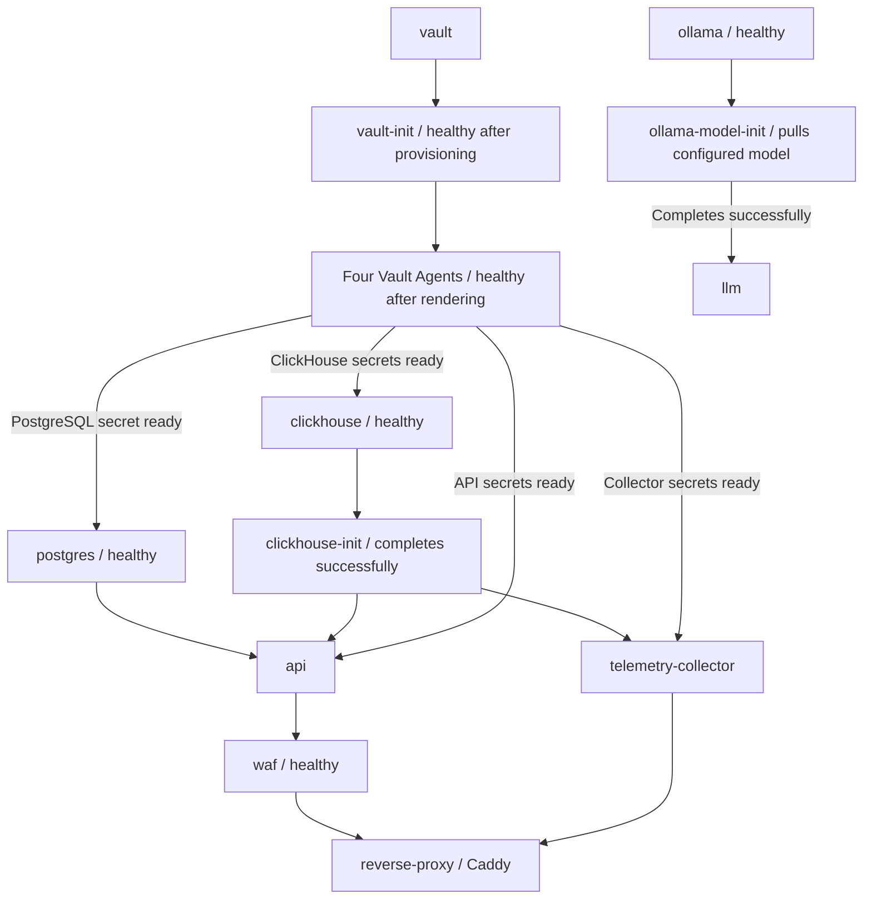
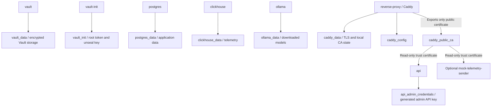

# Vigil Security Design

## 1. Ingress and Application Services

The WAF protects the API route within the wider application and telemetry pipeline:

Caddy remains the only public HTTPS entry point. The WAF inspects `/api/*` traffic before forwarding permitted requests to the API; WebSocket and SSE traffic use the same protected path. Frontend assets are served directly by Caddy, while OTLP is forwarded separately to the bearer-authenticated collector. The frontend is not a separate runtime container.

The collector writes telemetry as `vigil_writer`, while API telemetry queries use `vigil_api`. Its callback must be configured as `http://api:8081/internal/alerts/trigger-evaluation`; Caddy blocks `/internal` paths, and API port 8081 is not published. The API also calls the internal LLM service, which delegates inference to Ollama, and delivers notifications to configured external webhooks.

The WAF uses OWASP CRS with blocking enabled, paranoia level 2, and an inbound anomaly threshold of 5.

## 2. HashiCorp Vault

Vault provides centralized storage for application secrets.

Vault Agents authenticate through AppRole and render secrets into dedicated Docker volumes.

Applications read these generated files rather than retrieving secrets directly from Vault.

The API uses Spring Boot `configtree`, PostgreSQL uses `POSTGRES_PASSWORD_FILE`, and ClickHouse and the telemetry collector use secret-aware startup configurations.

Vault, bootstrap, and the four agents operate on a private Docker network without a publicly exposed Vault port. Consumer containers do not join that network; they receive files through their read-only secret mounts. Each agent mounts only its own AppRole credential volume. Caddy, WAF, the LLM service, and Ollama have no Vault secret mounts.

## 3. Initialization and Persistence

On first deployment, the Vault initialization service imports six initial secrets from the root `.env` file.

Vault data and initialization information are stored in persistent Docker volumes. Subsequent restarts reuse the existing Vault data.

The demonstration setup automatically initializes and unseals Vault. Startup also includes two one-shot application provisioning jobs:

Arrows in this diagram represent Compose startup dependencies, not request flow. Each consumer waits for its corresponding Vault Agent; the grouped agent node summarizes four independent readiness checks. The API has no Compose startup dependency on `llm`; model provisioning can complete separately.

Persistent state is separate from the rendered secret volumes:

The generated admin API key is not imported into Vault. Only Caddy's public root certificate is shared with consumers; its CA private key remains in Caddy's data volume. Back up Vault/bootstrap and database volumes consistently; replacing rendered secrets is not database password rotation.

## 4. Validation

Fresh deployment and merged single-file Docker Compose startup were tested successfully.

Verification included healthy Vault Agents and databases, successful API routing, and SQL injection blocking by the WAF.

## 5. Security Limitations

This implementation is intended for coursework and demonstration.

Vault uses a single node, file storage, internal HTTP communication, and locally stored initialization credentials. Production deployment would require stronger key protection, TLS, access-control review, and additional security testing.