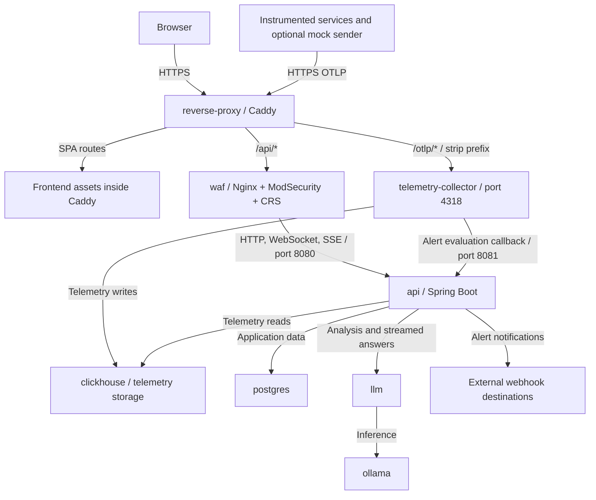
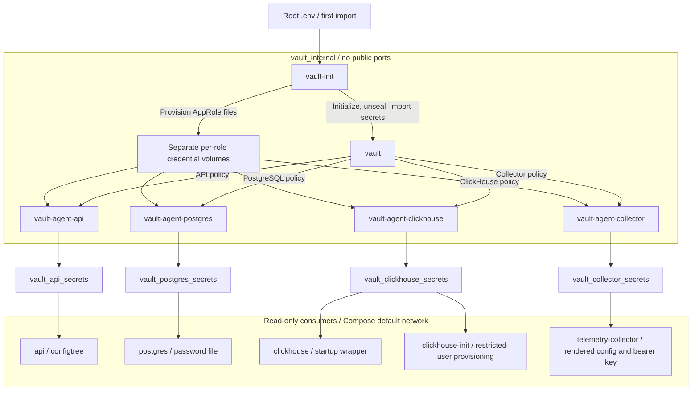
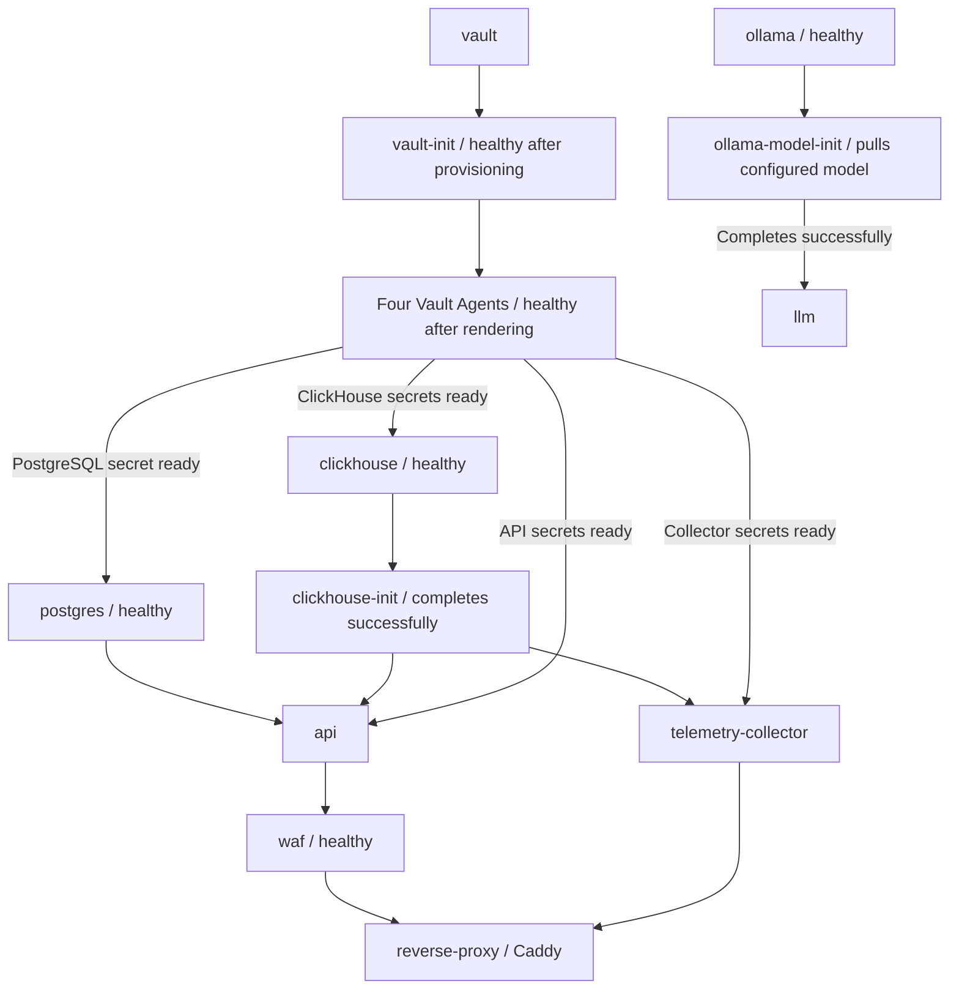
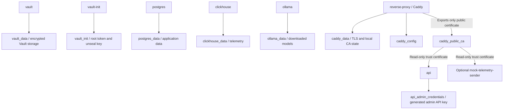

# Vigil Security Design

## 1. Ingress and Application Services

The WAF protects the API route within the wider application and telemetry pipeline:

Caddy remains the only public HTTPS entry point. The WAF inspects `/api/*` traffic before forwarding permitted requests to the API; WebSocket and SSE traffic use the same protected path. Frontend assets are served directly by Caddy, while OTLP is forwarded separately to the bearer-authenticated collector. The frontend is not a separate runtime container.

The collector writes telemetry as `vigil_writer`, while API telemetry queries use `vigil_api`. Its callback must be configured as `http://api:8081/internal/alerts/trigger-evaluation`; Caddy blocks `/internal` paths, and API port 8081 is not published. The API also calls the internal LLM service, which delegates inference to Ollama, and delivers notifications to configured external webhooks.

The WAF uses OWASP CRS with blocking enabled, paranoia level 2, and an inbound anomaly threshold of 5.

## 2. HashiCorp Vault

Vault provides centralized storage for application secrets.

Four AppRole-authenticated agents render files into dedicated volumes. The API reads Spring Boot `configtree`, PostgreSQL uses `POSTGRES_PASSWORD_FILE`, and ClickHouse and the collector use secret-aware startup configurations. The API and collector receive the same ingestion key; the collector reads it from a bearer-token file and uses a safely quoted writer password.

Vault, bootstrap, and the four agents operate on a private Docker network without a publicly exposed Vault port. Consumer containers do not join that network; they receive files through their read-only secret mounts. Each agent mounts only its own AppRole credential volume. Caddy, WAF, the LLM service, and Ollama have no Vault secret mounts.

## 3. Initialization and Persistence

Bootstrap reads six initial secrets from plain or quoted `.env` values as data, not shell code. The API document marks the one-time import. Restarts reuse Vault state and AppRole files, creating only missing credential files. A missing API ingestion key is copied from the existing collector document without rotating other secrets. Bootstrap does not reconcile documents or replace revoked AppRole credentials automatically.

The demonstration setup initializes and unseals Vault automatically, then marks bootstrap ready for the agents. Startup also includes two one-shot application provisioning jobs:

Arrows in this diagram represent Compose startup dependencies, not request flow. Each consumer waits for its corresponding Vault Agent; the grouped agent node summarizes four independent readiness checks. The API has no Compose startup dependency on `llm`; model provisioning can complete separately.

Persistent state is separate from the rendered secret volumes:

The generated admin API key is separate from Vault. Only Caddy's public root certificate is shared; its CA private key stays in Caddy's data volume. Preserve the existing database volume names and back up Vault/bootstrap and database state consistently. First-import credentials must match persisted databases; replacing rendered files is not password rotation. Do not delete volumes to migrate secret delivery.

## 4. Validation

See [security checks](tests/README.md) for smoke checks, isolated WAF tests, and `test-fullstack.py`, which exercises real Compose startup, authentication, ingestion, streaming, and inference. The separate [TLS runtime suite](../services/reverse-proxy/README.md#tests) reuses that harness. Neither suite is an exhaustive Vault recovery or database-upgrade test.

## 5. Security Limitations

This is a coursework/demo design: single-node file storage, internal Vault HTTP, locally stored root/unseal credentials, reusable AppRole credentials, and root-run agents. Secret files are readable inside their role-specific mounts. Docker-host compromise defeats these boundaries; production requires independent key protection, supported patched images, encrypted internal transport, access-control review, and further testing.