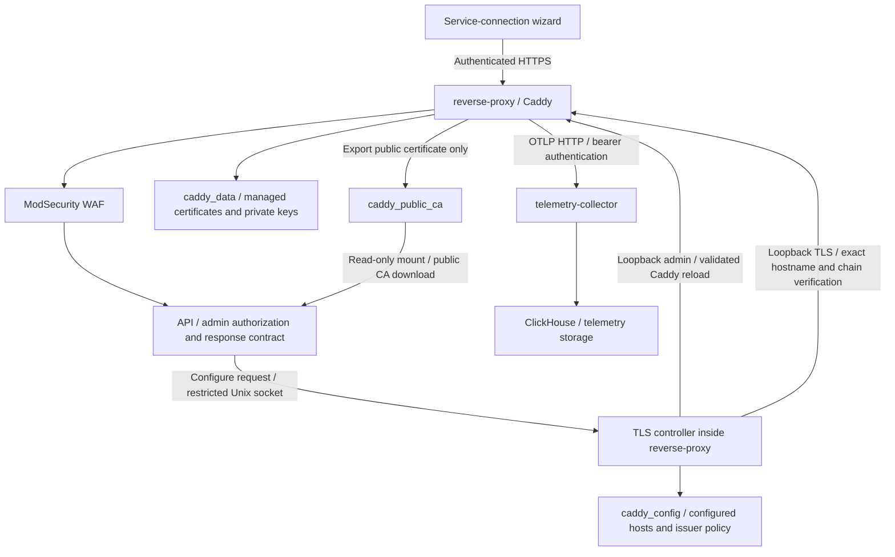

# TLS configuration

The service-connection wizard uses two admin-only API endpoints:

- `POST /api/config/tls/addresses`: configure an HTTPS origin and verify its certificate.
- `GET /api/config/tls/ca`: download the installation's public CA as `vigil-ca.crt`.

## Ownership and isolation



The API owns authorization and the frontend contract, not certificate issuance. The standard-library Go helper owns origin validation, issuer selection, Caddy reloads, persistence, and certificate verification. Caddy owns issuance and renewal.

Only the API and proxy mount the socket volume. The API's mount is read-only; connecting to a Unix socket still permits its constrained request protocol. The socket is `0600` and both containers currently run as root. If changing runtime UIDs, deliberately update socket ownership/group permissions instead of making it world-accessible.

Caddy's admin API remains loopback-only. The API has no Docker socket, Caddy admin network access, or mount of Caddy's private storage. It can download only parsed public CA certificate PEM data.

## Configure an address

Send an HTTPS origin, not an OTLP URL:

```http
POST /api/config/tls/addresses
Authorization: Bearer <admin access token>
Content-Type: application/json

{"address":"https://vigil.example.com:8443"}
```

The hostname is normalized to lowercase, the default port is omitted, and a trailing root slash is removed. Other paths, credentials, queries, fragments, wildcards, control characters, malformed hosts, and non-HTTPS schemes are rejected.

The external port is returned in the connection settings. It does not open a new proxy listener or change Docker port mappings. Configured hosts share Caddy's existing HTTPS listener and application/WAF/OTLP routes.

A verified response has HTTP `200`:

```json
{
  "address": "https://vigil.example.com:8443",
  "configured": true,
  "status": "verified",
  "tls_mode": "public",
  "otlp_endpoint": "https://vigil.example.com:8443/otlp",
  "ca_download_url": null,
  "code": "TLS_VERIFIED"
}
```

Repeated verified requests return HTTP `409` with the same usable settings and `code: "ALREADY_CONFIGURED"`, as supported by the frontend. Verification is performed again on every request. The first verified response after a helper restart can return `200` because the duplicate-response marker is not persisted.

DNS or certificate issuance in progress returns HTTP `202`:

```json
{
  "address": "https://vigil.example.com:8443",
  "configured": true,
  "status": "pending",
  "otlp_endpoint": "https://vigil.example.com:8443/otlp",
  "ca_download_url": null,
  "code": "CERTIFICATE_PENDING",
  "retry_after_seconds": 3
}
```

Pending responses do not include `tls_mode`. Unresolved DNS returns `configured: false` with `code: "DNS_PENDING"` and does not change Caddy configuration. Invalid origins return `400`; unavailable control/CA services return `503`. Anonymous and non-admin requests are rejected with `401` and `403`, respectively. Active WAF rules can reject malicious input before the API.

## Local and public trust

- `localhost`, IP literals, local names, and names resolving to private/reserved addresses use Caddy's internal CA. For example, `app-test.192.0.2.1.sslip.io` resolves to a documentation-only IP and therefore uses local trust.
- Names resolving exclusively to public addresses use Caddy's automatic public ACME issuance. There is no silent fallback to the local CA when public issuance fails.
- The selected issuer policy is persisted per hostname. Later DNS changes do not silently change its trust policy.
- There is a limit of 32 additional hostnames. `localhost` is always available and does not consume that limit.

Certificate verification connects only to Caddy's fixed loopback HTTPS listener with the exact hostname/SNI. Public mode verifies against system roots and rejects the installation's local CA; local mode verifies against its exported CA. User input is never used as an HTTP probe destination. A successful config reload alone is not verification.

This checks the certificate served by this proxy. It does not prove DNS, firewall rules, external port forwarding, or connectivity from the producer's network. Follow the wizard's separate reachability check from the actual service environment.

For public issuance, ACME challenges must reach Caddy on public port 80 for HTTP-01 or port 443 for TLS-ALPN-01. This stack publishes only HTTPS by default; configure the public mapping appropriately or provide a challenge tunnel for testing. The default host port 8443 is not a substitute for public ACME challenge ports.

## Public CA download

`GET /api/config/tls/ca` returns `application/x-pem-file`, `Content-Disposition: attachment; filename="vigil-ca.crt"`, and `Cache-Control: no-store`. Only bounded, parsed X.509 CA certificate PEM sections are accepted. Private keys, unrelated PEM sections, malformed files, and leaf certificates are never returned.

The CA endpoint and configuration endpoint both require admin authorization. Downloading the public CA does not install it in the producer; mount it read-only or configure the producer's trust store explicitly. Keep hostname verification enabled.

## Persistence and startup

The proxy prepares `/config/vigil-tls/Caddyfile` from the repository base configuration plus validated `/config/vigil-tls/hosts.json`, starts the socket helper, and runs Caddy using that generated configuration. The existing public-CA export continues to run independently.

The helper accepts a hostname only after Caddy accepts the candidate configuration. State writes use atomic renames; failures attempt rollback with an independent two-second cleanup deadline, even when the request has expired. Further changes are refused if rollback cannot establish a known configuration. Hosts and issuer choices survive proxy restarts. Caddy's existing data volume retains certificate/CA keys and renewals. Back up its config and data volumes together.

## Tests

API controller/service tests run with the API Maven suite. Helper unit tests run from `tls-control/` with `go test ./...`. Set `VIGIL_TLS_TEST_REAL_CADDY=1` only inside a disposable container with `/usr/bin/caddy` and ports 80, 443, and 2019 available to include real local issuance tests. See the Go test source for optional live public-certificate checks.

The endpoint runtime suite requires Python 3.10+, PyYAML, Docker Compose v2+, and current built API/proxy/collector/WAF images. It reuses the full-stack harness's isolation and cleanup, starts the 13-service non-AI dependency chain, and never uses the installation's `.env` or deployment volumes:

```sh
docker build -t vigil-api:tls-config services/api
docker build -t vigil-proxy:tls-config -f services/reverse-proxy/Dockerfile .
docker build -t vigil-collector:tls-config -f services/telemetry-collector/buildtime/Dockerfile services/telemetry-collector
docker build -t vigil-waf:tls-config security/waf
python3 services/reverse-proxy/tests/test-tls-config.py \
  --image api=vigil-api:tls-config \
  --image reverse-proxy=vigil-proxy:tls-config \
  --image telemetry-collector=vigil-collector:tls-config \
  --image waf=vigil-waf:tls-config
```

Pull the Vault, PostgreSQL, and ClickHouse images required by the synthetic test configuration before running the suite. `--validate-only` checks isolation without starting containers.

Add `--public-acme` to opt into a free temporary Cloudflare quick-tunnel hostname and real production Let's Encrypt issuance. The tunnel forwards HTTP-01 to Caddy's port 80. The test then connects directly to the loopback-published Caddy HTTPS port, uses the temporary hostname as SNI, and requires system-root trust, the exact SAN, and the production Let's Encrypt issuer. Cloudflare's edge certificate is not accepted as proof. The test also exercises authenticated API/OTLP requests through that direct Caddy TLS connection and checks persistence after restart.

Public testing requires network access, temporarily exposes the disposable test ingress, consumes production CA rate limits, and creates public certificate-transparency records. Only synthetic credentials/data are used. The tunnel, test containers, networks, and volumes are removed on completion or failure. It does not require a paid domain, Cloudflare account, DNS API token, or router port forwarding.
