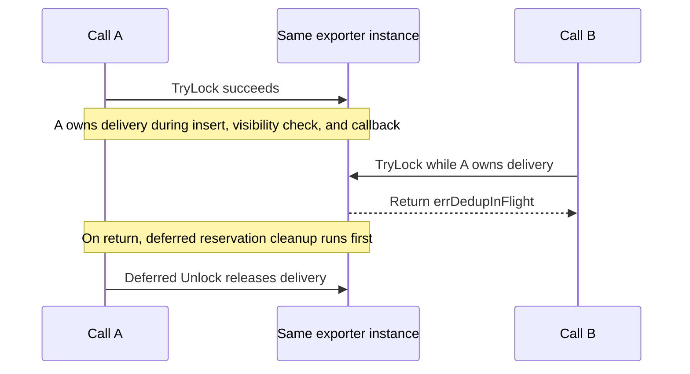
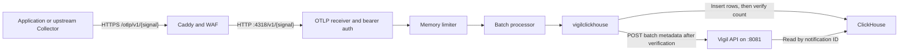

# Vigil telemetry collector

Vigil’s OpenTelemetry Collector receives OTLP logs, metrics, and traces over HTTP. Its custom `vigilclickhouse` exporter converts telemetry into ClickHouse rows, checks that the rows can be queried, and sends a batch notification to the Vigil API. The notification lets the API stream the stored telemetry and evaluate alert rules.

## How the collector runs concurrently

A goroutine is a task scheduled by the Go runtime. The runtime can run many goroutines across OS threads. In Vigil's configuration, the upstream batch processor starts one batching goroutine per signal pipeline. Receiver calls submit telemetry through a buffered channel. The batching goroutine waits for an item, a flush timer, or shutdown, then calls the signal's exporter synchronously when a batch is ready. The log, metric, and trace pipelines use distinct exporter instances and can make progress independently. See the [pinned batch processor source](https://github.com/open-telemetry/opentelemetry-collector/blob/cd3455cf3a7f672208140b1ebb1581c542b2b0ed/processor/batchprocessor/batch_processor.go) and the [Vigil factory](buildtime/exporter/factory.go).

### What each mutex protects

| Mutex | What it protects | How long it is held |
| --- | --- | --- |
| `Exporter.deliveryMu` | One delivery at a time on this exporter instance, including its `pending` slice. | From a successful `TryLock` until `deliver` returns. It stays held through ClickHouse I/O, callback attempts, and callback backoff. Row conversion happens before acquiring it. |
| `deduplicator.mu` | The shared key map and each reservation's `done` flag. | Briefly during reservation, commit, release, and expiry refresh. Database and callback requests run outside this mutex. |

`TryLock()` acquires the mutex and returns `true` if it is available. A concurrent call that gets `false` returns `errDedupInFlight` immediately. A successful call registers `defer exporter.deliveryMu.Unlock()` to release the mutex on any subsequent return. When delivery needs both locks, it already holds `deliveryMu` before acquiring `deduplicator.mu`. See [the delivery function](buildtime/exporter/delivery.go) and [the deduplicator](buildtime/exporter/dedup.go).



This shows two calls to the same instance. The configured batch worker calls its own exporter serially. The busy error indicates that a later call could try again. The configured upstream batch processor logs `Sender failed` on an export error and does not resubmit the failed batch. Vigil's visibility recovery runs when a subsequent call contains an overlapping row. See the [batch processor's send path](https://github.com/open-telemetry/opentelemetry-collector/blob/cd3455cf3a7f672208140b1ebb1581c542b2b0ed/processor/batchprocessor/batch_processor.go#L257-L276).

### Reservation ownership and deferred cleanup

The word *pending* refers to two stages in the code. A pending **dedup entry** belongs to a reservation that is still waiting for its insert result. A **pending delivery** already has an accepted insert and is waiting for visibility confirmation. Keeping the latter in `Exporter.pending` lets a later call resume at the visibility check with the original ID and row count.

`defer reservation.release()` registers cleanup once a claim succeeds. On an insert error, `release` deletes its pending keys so a later call can claim them. On a successful insert, `commit` changes the map entries to expiring keys and sets `done`, so the deferred release leaves them in place. Deferred calls run in reverse registration order, so reservation cleanup completes before `deliveryMu` is unlocked.

### How the concurrency test proves ownership

[`TestDedupConcurrentReservations`](buildtime/exporter/dedup_test.go) starts 32 goroutines with `waitGroup.Go(func() { ... })`. The function is a closure over the shared deduplicator, key, and result channel. Successful claimants use `winners <- reservation` to send their claim to a channel buffered for all 32 possible results. This makes it possible to wait for all goroutines before reading from the channel, even if a bug produces too many winners.

`waitGroup.Wait()` waits for the senders to finish. Then `close(winners)` marks the channel as finished, and ranging over it drains the buffered claims. The test keeps all successful reservations alive until the senders have finished, so the same key cannot legitimately be released and claimed again during the test. It expects exactly one winner.

## Go syntax used in the exporter

### Generics and functions passed as arguments

In `deliver[T any]`, `T` is one row type for the whole call. Go infers it from `rows []T`. When [`ConsumeLogs`](buildtime/exporter/exporter.go) supplies a `[]LogRow`, the compiler requires each function argument to use `LogRow` as well.

| Parameter | Meaning for a log delivery |
| --- | --- |
| `key func(T) dedupKey` | `logDedupKey` is passed as a function value. Delivery calls it to hash a row. |
| `fields func(T) (string, time.Time, map[string]string)` | An inline function supplies the service, event time, and attribute map. In `_, _, attributes := fields(row)`, each `_` discards a return value the caller does not need. |
| `insert func(context.Context, []T) error` | `exporter.Storage.InsertLogs` is a method value. It binds the current storage instance and can be called later as `insert(ctx, stored)`. |

The exporter can stamp a row through the returned attributes even when the row was passed by value. Copying the struct copies the map reference, so both copies refer to the same row-owned map. The conversion step created that map separately from the OTLP input. [`insertRows[T any]`](buildtime/exporter/storage.go) uses the same generic slice pattern so all three row types share one JSON encoder.

### Channels, cancellation, and retry timing

[`waitForCallback`](buildtime/exporter/callback.go) uses `select` to pause the current goroutine until a channel is ready. `<-ctx.Done()` receives when the context's cancellation channel closes. `<-timer.C` receives when the timer fires. `defer timer.Stop()` cleans up the timer if the wait ends through cancellation. The sleep and the HTTP attempts run inside the delivery call and keep its delivery lock held.

`context.WithTimeout(ctx, 10*time.Second)` returns both a child context and its cancel function. The request uses the child, so a parent cancellation or the attempt's own timeout can stop it. Calling `cancel()` explicitly releases the attempt's resources before backoff or the next request. In the configured pipeline, the batching worker derives its export context from a background context, so ending the original OTLP HTTP request does not itself cancel a batch already handed off to that worker. See the [batch processor's context and worker setup](https://github.com/open-telemetry/opentelemetry-collector/blob/cd3455cf3a7f672208140b1ebb1581c542b2b0ed/processor/batchprocessor/batch_processor.go#L146-L181).

`1 << attempt` shifts the binary value `1` left by the attempt number, giving `1` and `2` for the two retries. Multiplying by `time.Second` gives the base delay. Go represents `time.Duration` in nanoseconds, so the code converts the random nanosecond count back to a duration before adding the jitter.

### Interfaces, pointers, and slices

| Expression | What it means here |
| --- | --- |
| `var _ io.Writer = (*byteCounter)(nil)` | The blank identifier makes this a compile-time check that `*byteCounter` has the `Write` method required by `io.Writer`. The encoder gets a real pointer via `&size`. The pointer receiver and `*counter += ...` update that same counter across writes. |
| `config.(*Config)` or `http.DefaultTransport.(*http.Transport)` | These type assertions extract the concrete pointer stored inside an interface. A single-result assertion panics on a type mismatch. The factory supplies Vigil's `*Config`, and storage expects the standard HTTP transport so it can call `Clone`. |
| `text, ok := value.(string)` | This two-result assertion reports whether the value is a string. When it is another type, attribute conversion can use its JSON representation. |
| `append([]dedupKey(nil), reservation.keys...)` | Convert `nil` to an empty slice of keys and expand `reservation.keys` into individual arguments with `...`. The pending batch gets its own copy of the key list. |
| `append(exporter.pending[:i], exporter.pending[i+1:]...)` | Join the elements before and after index `i` and keep the returned slice. The next entry shifts into index `i`, which is why the removal path rechecks the same index. |
| `struct { Signal string; Row LogRow }{"logs", row}` | Declare and immediately initialize an anonymous struct. The dedup helper hashes its JSON, so the signal name and selected row fields form one input. |
| `id[6] = (id[6] & 0x0f) \| 0x40` | The AND mask keeps the lower four bits. The OR sets the upper four to binary `0100`, marking UUID version 4. The mask on `id[8]` sets the UUID variant bits to `10`. |
| `fmt.Errorf("insert %s: %w", signal, err)` | `%w` wraps the original error while adding context. Callers and tests can still inspect the cause with `errors.Is`. |

## Ingestion path



The main stack routes `/otlp/v1/logs`, `/otlp/v1/metrics`, and `/otlp/v1/traces` through Caddy and the WAF. The WAF's Nginx configuration strips `/otlp` and forwards the request to the Collector on port `4318`. The OTLP HTTP receiver authenticates it with `Authorization: Bearer <ingestion-key>`. The integration runner connects directly to the same receiver. Source files are the [reverse proxy configuration](../reverse-proxy/Caddyfile), [WAF routing](../../security/waf/nginx/default.conf.template), and [runtime Collector configuration](runtime/config.yaml).

### Build and startup

1. [The Dockerfile](buildtime/Dockerfile) copies the builder manifest and local Go exporter module into the OpenTelemetry Collector Builder image and runs `ocb`.
2. [The builder manifest](buildtime/builder-config.yaml) names the distribution `vigcol` and writes it to `/home/ocb/dist`. It selects the environment and file configuration providers, OTLP receiver, memory limiter, batch processor, bearer-token authentication extension, and Vigil exporter. Its module replacement resolves the exporter import to the copied source at `/home/ocb/exporter`.
3. The runtime stage uses a nonroot distroless image with the binary at `/vigcol`. It exposes port `4318` and defaults to `/vigcol --config /etc/vigcol/config.yaml`.
4. In the [main Compose stack](../../docker-compose.yml), the Collector waits for ClickHouse initialization and a healthy Vault agent, then starts with `--config /run/secrets/collector-config.yaml`. The [Vault agent](../../security/vault/agent/collector.hcl) renders the [Collector configuration template](../../security/vault/agent/collector-config.tpl) and the ingestion key file into the mounted directory. The template puts the ClickHouse password into YAML using JSON quoting and escapes dollar signs for Collector configuration expansion.
5. [The exporter factory](buildtime/exporter/factory.go) registers `vigilclickhouse` at the Collector's development stability level for all three signals. Each of the three factory functions calls `newExporter` and gets its own clients, deduplication state, and pending batches.

### Runtime components and settings

The `logs`, `metrics`, and `traces` pipelines all run `otlp → memory_limiter → batch → vigilclickhouse`. The memory limiter checks every second and applies the configured memory and spike limits. The batch processor flushes on its five-second timeout or when its 1,000-item send threshold is reached and caps outgoing batches at 5,000 items. The exporter applies a separate byte limit to the converted JSON rows. The bearer-token extension is both listed under `service.extensions` and referenced by the receiver.

| Setting | Source and validation |
| --- | --- |
| `clickhouse_endpoint` | `CLICKHOUSE_ENDPOINT`, set to `http://clickhouse:8123` in the main stack. Must parse as HTTP or HTTPS with a hostname. URL user information is rejected. |
| `clickhouse_database` | `CLICKHOUSE_DATABASE`, sourced from `CLICKHOUSE_DB` with a Compose fallback of `default`. Required and nonempty. |
| `clickhouse_username` | `CLICKHOUSE_USERNAME`, set to `vigil_writer` in the main stack. Required and nonempty. |
| `clickhouse_password` | The main stack uses the value rendered by Vault. The bundled runtime config reads `CLICKHOUSE_PASSWORD` from the environment. Required and nonempty. |
| `backend_callback_url` | `BACKEND_CALLBACK_URL`. The main stack uses `http://api:8081/internal/alerts/trigger-evaluation`. Must parse as HTTP or HTTPS with a hostname. Queries, a bare query marker, and nonempty fragments are rejected. |
| `max_serialized_batch_bytes` | `MAX_SERIALIZED_BATCH_BYTES` in the runtime configs. Must be greater than zero. The factory default and main Compose fallback are 1,048,576 bytes. |
| `dedup_window` | Set to `10m` in both runtime configs. Must be greater than zero. The factory provides the same ten-minute default. |
| Receiver ingestion key | The bundled runtime config uses `VIGIL_INGESTION_KEY` from the environment. The Vault-rendered config reads `/run/secrets/VIGIL_INGESTION_KEY`. |
| Memory limits | `COLLECTOR_MEMORY_LIMIT_MIB` and `COLLECTOR_MEMORY_SPIKE_LIMIT_MIB`. Main Compose fallbacks are 384 MiB and 96 MiB. |

[`Config.Validate`](buildtime/exporter/config.go) checks settings without contacting either service. [`newExporter`](buildtime/exporter/exporter.go) runs validation, initializes the ClickHouse client, an HTTP callback client, the deduplicator, and the production clock, UUID generator, and retry wait function. With a Collector meter provider, it creates the `vigil.exporter.callback.failures` counter under the `vigilclickhouse` meter. The lifecycle `Start` method returns immediately and connections open on demand. `Shutdown` closes idle connections. `Capabilities` declares that the exporter leaves the original telemetry intact.

## OTLP to ClickHouse rows

[The conversion code](buildtime/exporter/rows.go) traverses each signal's resource groups, instrumentation scopes, and individual records or points. Every resource group must have a string `service.name` that remains nonempty after trimming whitespace. The actual stored service name retains its original text. A conversion error returns no partial row slice and the signal consumer marks the error permanent. A signal with zero converted rows returns successfully without contacting ClickHouse or the API.

All stored event timestamps use UTC with millisecond precision. Every row gets its own `attributes` map. Resource strings remain strings and other marshalable resource values are stored as JSON text. A resource value that fails JSON encoding is skipped. Item attributes use the OpenTelemetry `AsString` representation and override any resource attribute with the same key. For example, a Boolean becomes `"true"`, bytes become Base64 text, and a structured map becomes JSON text. The resource supplies the dedicated `service` column even when an item overrides `service.name` in the merged attributes.

### Logs

| Column | Source |
| --- | --- |
| `service` | Resource `service.name`. |
| `timestamp` | Record event timestamp. A zero event timestamp is rejected. |
| `severity` | Normalized severity using the rules below. |
| `message` | Log body converted with `AsString()`. |
| `attributes` | Resource attributes merged with log record attributes. |

Severity numbers 1 through 24 are grouped in fours and map in order to `trace`, `debug`, `info`, `warning`, `error`, and `critical`. Without an in-range number, the converter trims the severity text and matches it case-insensitively. It accepts `TRACE`, `DEBUG`, `INFO`/`INFORMATION`/`INFORMATIONAL`, `WARN`/`WARNING`, `ERROR`/`ERR`, and `FATAL`/`CRITICAL`/`CRIT`. Other text maps to `unspecified`. The stored log schema consists of the five columns above.

### Metrics

The converter emits one row per point. Every metric name must contain a non-whitespace character. Every point needs a nonzero timestamp and must clear the OTLP `NoRecordedValue` flag. Unsupported types such as summaries are rejected.

| OTLP kind | Stored kind | Stored values |
| --- | --- | --- |
| Gauge | `gauge` | Numeric `value`, `unspecified` temporality, and null `is_monotonic`. |
| Sum | `sum` | Numeric `value`, OTLP temporality, and a Boolean `is_monotonic`. |
| Histogram | `histogram` | `histogram_count`, optional `histogram_sum`, and OTLP temporality. |
| Exponential histogram | `exponential_histogram` | `histogram_count`, optional `histogram_sum`, and OTLP temporality. |

For types with an OTLP temporality, `delta` and `cumulative` retain their meaning and other values map to `unspecified`. Gauge and sum points carry either a double or an integer between `-2^53` and `2^53` inclusive, which the exporter can represent exactly as a Float64. Values and present histogram sums must be finite. Histograms have null `value` and `is_monotonic`. Gauges and sums have null histogram columns.

Every row also has `service`, `timestamp`, `name`, `unit`, `start_timestamp`, `series_id`, and `attributes`. The optional start timestamp is null when the OTLP start timestamp is zero. The attribute map combines resource and point attributes. The instrumentation scope is part of series identity.

There are two separate SHA-256 hashes over JSON with sorted map keys. Both are encoded as lowercase hexadecimal strings.

| Hash | Inputs and purpose |
| --- | --- |
| `series_id` | Service, raw resource attributes, scope name, scope version, raw scope attributes, metric name, unit, kind, temporality, raw point attributes, and monotonicity for sums. It identifies a series across point values and timestamps and is stored in ClickHouse. |
| `DedupPayload` | Raw point attributes plus the normalized numeric value, or the histogram count, optional sum, and bucket layout. It stays in memory as an input to the metric deduplication key. |

Histogram payload hashing includes explicit bounds and bucket counts. Exponential histogram payload hashing includes scale, zero count, zero threshold, and the offsets and bucket counts for both the positive and negative sides. ClickHouse stores the count and optional sum for both histogram types. The hash helper expects JSON-encodable metadata and panics if marshaling fails. Bucket arrays, histogram min/max, exemplars, and metric descriptions have no columns in this schema.

### Traces

| Column | Source |
| --- | --- |
| `trace_id`, `span_id` | String forms of the required nonempty OTLP identifiers. |
| `parent_span_id` | Parent identifier as a string, or null for an empty identifier. |
| `name` | Span name. A whitespace-only name is rejected. |
| `service` | Resource `service.name`. |
| `timestamp` | Span start timestamp in UTC, truncated to milliseconds. |
| `duration_ms` | End minus start in nanoseconds, then truncated to whole milliseconds. |
| `status` | `unset`, `ok`, or `error` from the OTLP status code. Other codes are rejected. |
| `attributes` | Resource attributes merged with span attributes. |

Both timestamps must be present and end must be at or after start. The converter subtracts raw unsigned nanoseconds to avoid overflowing a Go `time.Duration` before conversion. It rejects any duration whose truncated millisecond count is larger than `4,294,967,295`, the limit for the UInt32 ClickHouse column. The stored schema contains only the fields above. Span events, links, and status descriptions are outside that schema.

## Delivery, deduplication, and recovery

[`deliver`](buildtime/exporter/delivery.go) is the shared delivery function. The signal consumers supply its row type, a dedup key function, an accessor for service and timestamp metadata, and the corresponding insert function.

1. **Acquire delivery ownership.** Empty input returns immediately. For a nonempty batch, `TryLock` either acquires the delivery lock or returns the busy error described above.
2. **Prepare and size the incoming batch.** Generate a random UUID v4 and compute each row's dedup key before stamping `attributes["vigil.notification_id"]`. The exporter replaces any value at that key in the copied map. It then counts the bytes produced by Go's JSON encoder, including one newline per row, without keeping a second copy of the body. The limit applies to all incoming rows before deduplication. Exactly the configured size is allowed. Serialization errors and oversized input produce permanent errors before any storage activity.
3. **Finish any overlapping pending batch.** Each pending item represents a successful insert that still needs visibility confirmation. An incoming key matching any of its keys triggers a check with the original ID and expected row count. If the check fails, return that error and leave the pending item available for a later matching call. If it succeeds, use the original service metadata for the callback and remove the pending item. Exclude all recovered keys from the current insert, even when their original dedup window has elapsed.
4. **Reserve new row keys.** [The deduplicator](buildtime/exporter/dedup.go) locks its map and removes committed entries whose expiry is at or before now. A matching in-flight reservation returns an error before claiming any new keys. Committed duplicates are skipped. Within one incoming batch, the first occurrence of a new key is retained and further copies are skipped. An all-duplicate batch returns without inserting.
5. **Insert the retained rows.** Build the per-service maximum event timestamps from the retained rows alone. Save the generated ID, signal, sorted service metadata, accepted keys, and inserted row count as the pending batch record. If the insert reports an error, release its reservations so a later attempt can claim the keys again. If the insert succeeds, commit the reserved keys with an expiry and save the pending record before checking visibility.
6. **Verify visibility and notify.** Query the exact row count by the stamped ID. A visibility error keeps the pending batch. A successful check sets `stored_at` from the exporter clock, refreshes the keys' dedup expiry to that time plus the configured window, and attempts the callback. The pending batch is removed after callback processing. Callback failure is reported separately and delivery returns success for the stored rows.

| Signal | Identity hashed for deduplication |
| --- | --- |
| Logs | Signal marker and the whole normalized log row before stamping. Service, timestamp, severity, message, and merged attributes all contribute. An input-supplied `vigil.notification_id` attribute therefore contributes to this hash even though its stored value is replaced. |
| Metrics | Signal marker, series ID, normalized point timestamp, nullable start timestamp, and point payload hash. A value change in the same series at the same time can produce a distinct row. |
| Traces | Signal marker, trace ID, and span ID. A retry with changes to other fields still has the same span identity. |

Dedup entries and pending batches live in memory on each exporter instance. Expired dedup entries are cleaned up when `reserve` runs. Pending batches are recovered through overlapping input and remain in memory while waiting. Restarts and other Collector replicas have independent state. Once a dedup window expires, a subsequent duplicate can be stored with a new UUID. If ClickHouse commits a request whose success response the exporter never receives, the insert error releases the keys and a later attempt can write duplicate data. The ClickHouse tables use MergeTree and the dedup window provides best-effort process-local suppression.

For example, a batch stores two logs and its visibility query times out. A later batch contains one of those logs and a new log. The exporter checks the original two rows by their original ID, sends the original callback if they are visible, then inserts only the new log with the new ID.

## ClickHouse HTTP protocol

[`Storage`](buildtime/exporter/storage.go) defines the three insert methods, visibility confirmation, and cleanup. Its production implementation uses an HTTP client with a cloned default transport and a ten-second timeout.

- Each insert sends an HTTP `POST` with `INSERT INTO <table> FORMAT JSONEachRow` as the `query` parameter. The body has one JSON object per line and uses `Content-Type: application/x-ndjson`. Empty inserts return before creating a request.
- Requests include the configured database and the parameters `async_insert=0`, `wait_end_of_query=1`, and `date_time_input_format=best_effort`. The first two settings wait for the query to finish. The datetime setting lets ClickHouse parse Go's JSON timestamps. Credentials go in `X-ClickHouse-User` and `X-ClickHouse-Key`.
- The client expects HTTP `200` and reads at most 1,048,577 response bytes so it can reject bodies exceeding 1,048,576 bytes. For inserts, the successful response body is empty or whitespace only. Unexpected text with HTTP `200` can represent a late query error.
- Visibility checks require one of the three known signal names, a nonempty ID, and a positive expected count. The query counts rows in the signal table where `attributes['vigil.notification_id']` equals a bound string parameter sent as `param_notification_id`. The response must be a plain unsigned integer in `TabSeparated` format that equals the expected count exactly. A missing, extra, or malformed count fails confirmation.
- The [schema initialization script](../telemetry-db/clickhouse-init.sh) creates three MergeTree tables with monthly partitions and a 30-day TTL based on the event timestamp. Timestamp columns use UTC `DateTime64(3)` and attributes are `Map(String, String)`. The writer needs `INSERT` for rows and `SELECT` for visibility. The API queries them using its own reader account.

## Backend callback

[`callback.go`](buildtime/exporter/callback.go) sends an HTTP `POST` with `Content-Type: application/json` to the configured callback URL. Here is an example request body for a stored log batch.

```json
{
  "notification_id": "14bff82a-f28b-4b0b-95a7-86c16a05d130",
  "signal_type": "logs",
  "stored_at": "2026-01-15T09:01:01.2Z",
  "services": [
    {"service": "checkout-api", "latest_timestamp": "2026-01-15T09:00:59.71Z"}
  ]
}
```

`stored_at` is the time at which visibility was confirmed. `latest_timestamp` is the latest stored event time for that service within this batch. Service names appear once each and are sorted lexicographically. Callback retries reuse the exact serialized payload and the same UUID.

The callback has a ten-second per-attempt deadline and accepts only HTTP `204 No Content` as success. The HTTP client returns redirect responses to the exporter. Transport errors and HTTP `5xx` responses can trigger up to two retries, for a maximum of three attempts. The first delay is one second plus jitter and the second is two seconds plus jitter. Each jitter value is in `[0, 250ms)`. Cancellation of the parent context stops retrying or interrupts the wait. Each available response body is drained up to 4 KiB and closed.

An unsuccessful callback after the retry policy increments `vigil.exporter.callback.failures` if a meter was supplied. If a logger is available, it emits `telemetry stored but callback failed` with the notification ID, signal, and error. The batch remains stored and the exporter finishes delivery. The callback is best effort. Retries are limited to the delivery call, and a lost response can cause the API to receive the same ID more than once.

The [API callback handler](../api/src/main/java/com/ft_transcendence/vigil/domain/dtos/ingest/IngestController.java) serves the route on the internal port `8081`, validates the request, and requires unique service names. [The ingest service](../api/src/main/java/com/ft_transcendence/vigil/services/IngestService.java) reads rows by notification ID for server-sent events, updates service silence timers using `stored_at`, and evaluates enabled alert rules using each service's latest event timestamp.

## Source and test reference

| File | Responsibility |
| --- | --- |
| [`buildtime/Dockerfile`](buildtime/Dockerfile) | Builds `vigcol` with OCB and packages the binary and default config. |
| [`buildtime/builder-config.yaml`](buildtime/builder-config.yaml) | Selects the Collector components and substitutes the local exporter module. |
| [`runtime/config.yaml`](runtime/config.yaml) | Bundled runtime config and shared component order for each signal. |
| [`buildtime/exporter/go.mod`](buildtime/exporter/go.mod) and [`go.sum`](buildtime/exporter/go.sum) | Declare the Go 1.26 module and dependency versions and record dependency checksums. |
| [`factory.go`](buildtime/exporter/factory.go) and [`config.go`](buildtime/exporter/config.go) | Register the component, supply defaults, map configuration keys, and validate settings. |
| [`exporter.go`](buildtime/exporter/exporter.go) | Implements the signal consumers and lifecycle, wires dependencies, and generates notification UUIDs. |
| [`rows.go`](buildtime/exporter/rows.go) | Defines ClickHouse JSON rows and converts OTLP data, including metric identity and attribute formatting. |
| [`delivery.go`](buildtime/exporter/delivery.go) and [`dedup.go`](buildtime/exporter/dedup.go) | Measure batches, track row keys and reservations, coordinate inserts, and recover visibility failures. |
| [`storage.go`](buildtime/exporter/storage.go) and [`callback.go`](buildtime/exporter/callback.go) | Implement the ClickHouse and backend HTTP calls. |
| [`config_test.go`](buildtime/exporter/config_test.go) | Tests required configuration fields, URL rules, and dedup defaults and overrides. |
| [`exporter_test.go`](buildtime/exporter/exporter_test.go) | Tests production time and UUID sources and their replaceable test hooks. |
| [`rows_test.go`](buildtime/exporter/rows_test.go) | Tests severity, attribute types, resource and scope traversal, row conversion, and invalid inputs and boundaries. |
| [`dedup_test.go`](buildtime/exporter/dedup_test.go) | Tests signal-specific keys, first-occurrence selection, concurrent reservation conflicts, release, commit, and expiry. |
| [`storage_test.go`](buildtime/exporter/storage_test.go) | Uses an HTTP test server to check insert wire format, credentials, visibility counts, invalid inputs, and failure responses. |
| [`delivery_test.go`](buildtime/exporter/delivery_test.go) | Uses fake storage and an HTTP callback server to check operation order, row byte limits, visibility recovery, expiration, retry timing, and failure reporting. |
| [`integration/compose.yaml`](integration/compose.yaml) | Starts a disposable ClickHouse instance, runs the schema initializer, builds the Collector, starts the mock backend, and waits for receiver and backend reachability. |
| [`integration/collector_integration.py`](integration/collector_integration.py) | Expects an unauthenticated request to return `401`, submits one authenticated item per signal, and polls for one row per table and three callbacks. |
| [`integration/mock_backend.py`](integration/mock_backend.py) | Validates the callback route, JSON field names, signal type, and presence of services. Accepted callbacks return `204` and are counted at `GET /count`. |

### Run the unit tests

With Go 1.26 or later, run these commands from the repository root.

```sh
cd services/telemetry-collector/buildtime/exporter
go test -race ./...
```

### Run the integration test

With Docker Compose, run these commands from the repository root.

```sh
docker compose -p vigil-collector-integration -f services/telemetry-collector/integration/compose.yaml run --build --rm otlp-test
docker compose -p vigil-collector-integration -f services/telemetry-collector/integration/compose.yaml down
```

The readiness container treats any HTTP response as proof that the target is reachable. The test runner checks authentication and polls for storage and callback results because the batch processor can flush after the receiver answers the OTLP request. The mock backend serializes updates to its callback list across request threads.
